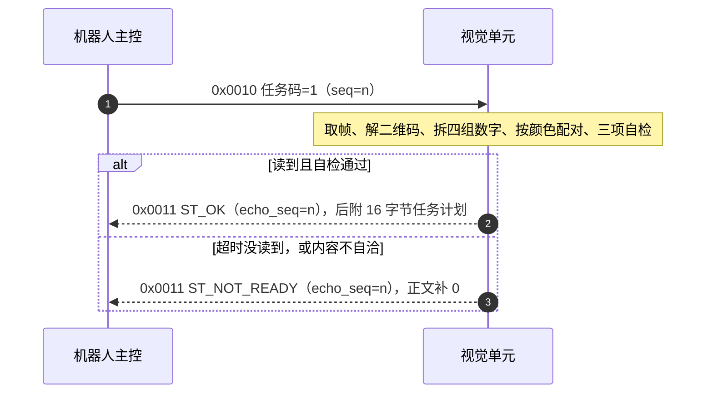
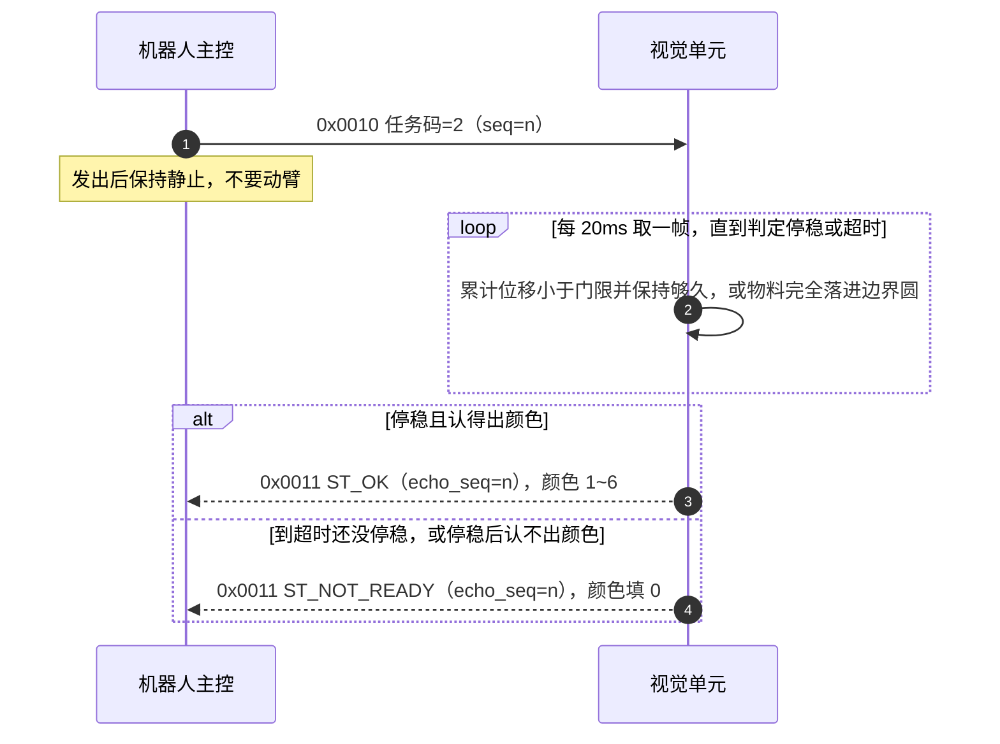
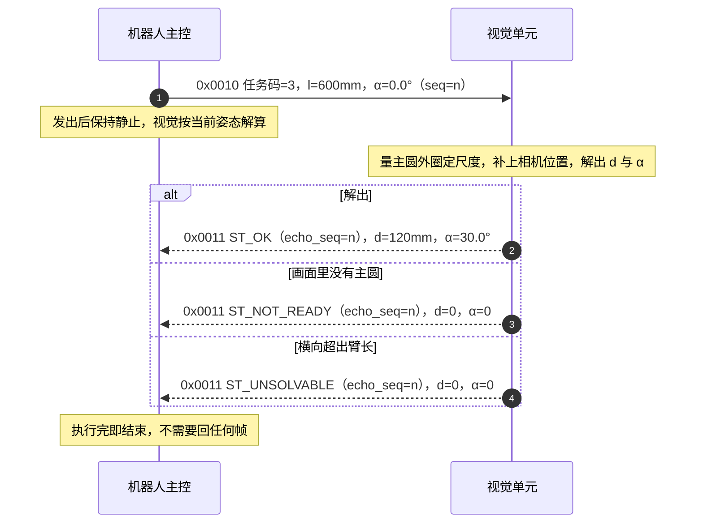
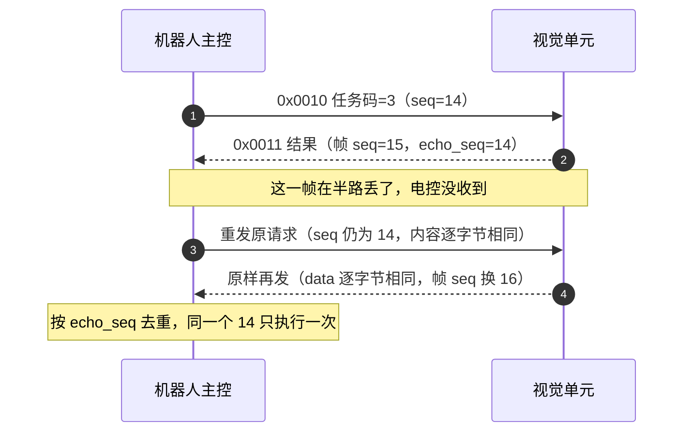

# 工创赛智能搬运视觉单元通信协议 V2.2.0

分工只有一条：**视觉只测量，电控全执行**。视觉回答三个问题——任务计划是什么、转盘取料点此刻是什么颜色、把相机对准主圆要动多少——不规划路径、不判断动作完成、不主动上报任何东西。视觉平时一句话都不说，电控发来请求才回一帧。

帧格式、帧头定义与校验算法参照《RoboMaster 2027 机甲大师高校系列赛通信协议 V1.0.0》，命令码与数据段为本赛项自定义。

## 1.1 串口协议格式

8 位数据位、1 位停止位、无硬件流控、无校验位，波特率 115200。

表 1-1 波特率

| 物理接口 | 波特率 |
|---|---|
| 视觉单元←→机器人主控 | 115200 |

表 1-2 通信协议格式

| frame_header | cmd_id | data | frame_tail |
|---|---|---|---|
| 5-byte | 2-byte | n-byte | 2-byte，CRC16，整包校验 |

表 1-3 frame_header 格式

| SOF | data_length | seq | CRC8 |
|---|---|---|---|
| 1-byte | 2-byte | 1-byte | 1-byte |

表 1-4 帧头详细定义

| 域 | 偏移位置 | 大小（字节） | 详细描述 |
|---|---|---|---|
| SOF | 0 | 1 | 数据帧起始字节，固定 0xA5 |
| data_length | 1 | 2 | data 长度加 2（含 cmd_id 的 2 字节），小端 |
| seq | 3 | 1 | 包序号 |
| CRC8 | 4 | 1 | 覆盖偏移 0~3 共 4 字节 |

- `data_length` 的取值范围为 2~1026，越界判定为坏帧。一帧总长 = 5 + `data_length` + 2。
- `frame_tail` 的 CRC16 覆盖「除自身外的全部字节」，即 `frame_header`（含 CRC8）+ `cmd_id` + `data`。
- 多字节字段一律小端。
- 两侧 `seq` 各自独立，从 1 递增到 255 后回到 1，0 不用。
- **重发时 `seq` 不变**：递增只描述新帧，重发的是同一帧、内容逐字节相同。
- 接收方必须流式解析，抗粘包与断包；没收全就留着等下一批，不得报错丢弃。

## 1.2 命令码与任务码

表 1-5 命令码 ID 一览

| 命令码 | 数据段长度 | 说明 | 发送方/接收方 |
|---|---|---|---|
| 0x0010 | 1 / 1 / 5 | 请求，data 首字节是任务码 | 机器人主控→视觉单元 |
| 0x0011 | 19 / 4 / 7 | 结果，data 前 3 字节为 `echo_seq`、任务码、状态码 | 视觉单元→机器人主控 |

表里三个数字依次对应任务码 1、2、3。**先读任务码，再按表 1-6 校验长度**；长度不对按 `ST_BAD_REQUEST` 处理，不要盲目解析。

本协议只使用这两条命令。下列命令码为保留值，收到时静默丢弃并计数，不回应、不改状态：

```
0x0001  0x0002  0x0003  0x0004  0x0005  0x0006  0x0007  0x0008
0x0201  0x0202  0x0203
```

表 1-6 任务码一览

| 任务码 | 用途 | 请求 data 长度 | 结果 data 长度 | 说明 |
|---|---|---|---|---|
| 1 | 扫码，要任务计划 | 1 | 19 | 3 字节头 + 16 字节任务计划 |
| 2 | 转盘取料点此刻的颜色 | 1 | 4 | 3 字节头 + 颜色 1 字节 |
| 3 | 对准主圆，要 d 与 α | 5 | 7 | 3 字节头 + d(2) + α(2) |

任务码之外的取值一律回 `ST_BAD_REQUEST` 并回显该任务码，便于电控定位。

## 1.3 数据段详细定义

表 1-7 结果数据段的公共头

| 字节偏移量 | 大小 | 说明 |
|---|---|---|
| 0 | 1 | `echo_seq`：被回应的那条 `0x0010` 的 seq，原样回带 |
| 1 | 1 | 任务码，与请求一致（请求不合法时回显收到的值） |
| 2 | 1 | 状态码，见表 1-11 |

```
typedef __packed struct
{
  uint8_t echo_seq;
  uint8_t task;
  uint8_t status;
}result_header_t;
```

`echo_seq` 是电控唯一可靠的配对依据：帧自己的 `seq` 由视觉递增，与请求无关。

**失败帧长度与成功帧完全一致，缺的内容填 0。** 电控按任务码一次读满固定字节数，不必处理「这次正文短了」的分支。例外：任务码不认识时不知该补到多长，只回 3 字节。

### 表 1-8 任务码 1：扫码

表 1-8.1 请求（任务码 1）

| 字节偏移量 | 大小 | 说明 |
|---|---|---|
| 0 | 1 | 任务码，固定为 1 |

表 1-8.2 结果（任务码 1）

| 字节偏移量 | 大小 | 说明 |
|---|---|---|
| 0 | 3 | 公共头，见表 1-7 |
| 3 | 3 | 第 1 组：第一批 3 件的颜色与搬运顺序，每字节 1~6 |
| 6 | 3 | 第 2 组：第一批在粗加工区与暂存区的靶号，每字节 1~3，两处通用 |
| 9 | 3 | 第 3 组：第二批 3 件的颜色与搬运顺序，每字节 1~6 |
| 12 | 3 | 第 4 组：第二批在**粗加工区**的靶号，每字节 1~3 |
| 15 | 3 | 第二批在**暂存区**的靶号，每字节 1~3，由视觉按颜色配对算得 |
| 18 | 1 | 校验字节 |

```
typedef __packed struct
{
  result_header_t header;
  uint8_t batch1_color[3];
  uint8_t batch1_ring[3];
  uint8_t batch2_color[3];
  uint8_t batch2_ring_rough[3];
  uint8_t batch2_ring_staging[3];
  uint8_t plan_status;
}scan_result_t;
```

校验字节：

| 位 | 含义 |
|---|---|
| bit 0 | 两批颜色集合能配对（1 为能） |
| bit 1 | 保留，固定 0 |
| bit 2 | 第 2 组是 1~3 的一个排列（1 为是） |
| bit 3 | 第 4 组是 1~3 的一个排列（1 为是） |
| bit 4~6 | 保留，固定 0 |
| bit 7 | 整份计划可用（1 为可用，0 时不得按本帧规划路径） |

对应关系（不得按颜色查表）：

1. 第 1 组第 i 位是第一批第 i 件的颜色，第 2 组第 i 位是它要去的靶号。
2. 第 3 组第 i 位是第二批第 i 件的颜色，第 4 组第 i 位是它在**粗加工区**的靶号。
3. 结果第 15~17 字节第 i 位是第二批第 i 件在**暂存区**的靶号。
4. 暂存区靶号 = 「在第一批中找与第二批第 i 件同色的物料，取其第 2 组靶号」。同批内颜色互不相同（赛题保证），结果唯一。

示例：二维码 `452+321+254+312`

| 批次 | 件序 | 颜色 | 粗加工区靶 | 暂存区靶 |
|---|---|---|---|---|
| 第一批 | 1 | 4 | 3 | 3 |
| 第一批 | 2 | 5 | 2 | 2 |
| 第一批 | 3 | 2 | 1 | 1 |
| 第二批 | 1 | 2 | 3 | 1 |
| 第二批 | 2 | 5 | 1 | 2 |
| 第二批 | 3 | 4 | 2 | 3 |

第二批在暂存区码垛在第一批之上，上下两层同色。上表第二批第 1 件颜色 2，第一批颜色 2 的在 1 号靶，故暂存区靶号为 1。

回帧前先做三项自检，任一不通过就**不回计划**，改回 `ST_NOT_READY`：颜色能一一配对、第 2 组是 1~3 的排列、第 4 组是 1~3 的排列。宁可让电控再问一次，也不发错的计划——错的计划不报任何错，只会让车开到错的靶位。

### 表 1-9 任务码 2：转盘取料点此刻的颜色

表 1-9.1 请求（任务码 2）

| 字节偏移量 | 大小 | 说明 |
|---|---|---|
| 0 | 1 | 任务码，固定为 2 |

表 1-9.2 结果（任务码 2）

| 字节偏移量 | 大小 | 说明 |
|---|---|---|
| 0 | 3 | 公共头 |
| 3 | 1 | 颜色编号 1~6，与任务计划一致；`ST_OK` 之外不得使用 |

```
typedef __packed struct
{
  result_header_t header;
  uint8_t color;
}pick_color_result_t;
```

**这是等待型任务。** 电控把臂悬停在取料点上方后发请求，此时转盘可能还在转，视觉连续取帧、自己判定停稳，才回颜色。电控**不需要也不应该**告知「现在已经停了」。

停下判定由视觉配置 `turntable.stop_strategy` 选，协议层面完全一致：

| 取值 | 判据 |
|---|---|
| `motion`（缺省） | 离取料点最近的物料，相对计时起点的累计位移持续小于 `tol_mm` 达 `hold_s`，且离取料点不超过 `pick_tol_mm` |
| `containment` | 某块物料完全落进以取料点为圆心、半径 `物料半径 × containment_margin` 的边界圆 |

判据用「相对计时起点的累计位移」而非「相邻帧位移」：转盘 6s 一圈、工位半径 150mm 时取料点附近约 150mm/s，20ms 一帧只走 3mm，任何能容忍抖动的门限都会把转着的转盘判成停稳。

停稳后回 `ST_OK` 与颜色。超时未停或停稳后认不出颜色，回 `ST_NOT_READY`，颜色填 0（长度仍是 4 字节）。**填 0 只是占位，不是「空位」这个结论**——电控只看状态码。绝不能猜一个颜色充数：取错颜色会让整垛都错，且不报错。

转盘上没有已知尺寸的参考物，这一条的像素到毫米换算**只能**用相机外参的 `scale_mm_per_px`。无有效外参时一律回 `ST_NOT_READY`，不会用假设尺度硬算——那样颜色可能对，但「离取料点多远」全错，停稳判定也不可信。

### 表 1-10 任务码 3：对准主圆

表 1-10.1 请求（任务码 3）

| 字节偏移量 | 大小 | 说明 |
|---|---|---|
| 0 | 1 | 任务码，固定为 3 |
| 1 | 2 | 机械臂水平伸出长度 l，单位 mm，无符号 |
| 3 | 2 | 臂当前 yaw α，单位 0.1°，有符号，从 +x 量起、向 +y 为正 |

```
typedef __packed struct
{
  uint8_t task;
  uint16_t arm_length;
  int16_t arm_yaw;
}align_request_t;
```

表 1-10.2 结果（任务码 3）

| 字节偏移量 | 大小 | 说明 |
|---|---|---|
| 0 | 3 | 公共头 |
| 3 | 2 | 车沿自身 x 轴要移动的 d，单位 mm，有符号，正为前进 |
| 5 | 2 | 臂应转到的 yaw α，单位 0.1°，有符号，从 +x 量起、向 +y 为正 |

```
typedef __packed struct
{
  result_header_t header;
  int16_t shift_x;
  int16_t arm_yaw;
}align_result_t;
```

**返回体只有 d 与 α。** 坐标是中间量，电控执行只认 d 与 α；能不能算由状态码表达，比让电控读一串位域可靠。

电控在等结果期间必须保持静止：视觉按「当前姿态」解算，期间动了，解出的 d 与 α 就对应一个已不适用的姿态。

## 1.4 字节级样例

全部由 `encode()` 实际运行输出，可直接用作收发单测的黄金样例。

任务码 1 请求（`seq=10`，data_length=3，总长 10）：

```
a5 03 00 0a 59 | 10 00 | 01 | 50 ca
```

任务码 1 结果（回 `seq=10`，`seq=11`，data_length=21，总长 28）：

```
a5 15 00 0b 9c | 11 00 | 0a 01 00 | 04 05 02 03 02 01 02 05 04 03 01 02 01 02 03 8d | 19 53
```

任务码 2 请求（`seq=12`）：

```
a5 03 00 0c 84 | 10 00 | 02 | a4 b0
```

任务码 2 结果（回 `seq=12`，颜色 4，`seq=13`）：

```
a5 06 00 0d ef | 11 00 | 0c 02 00 04 | 2e c0
```

任务码 3 请求（`seq=14`，l=600mm，α=15.0°）：

```
a5 07 00 0e a6 | 10 00 | 03 58 02 96 00 | 1c e1
```

任务码 3 结果（回 `seq=14`，d=120mm，α=30.0°，`seq=15`）：

```
a5 09 00 0f 0c | 11 00 | 0e 03 00 78 00 2c 01 | 29 09
```

任务码 2 的「没测到」（回 `seq=12`，`ST_NOT_READY`，正文补 0）：

```
a5 06 00 10 8f | 11 00 | 0c 02 01 00 | f2 da
```

## 1.5 三条任务的时序

每个任务都是**一次请求换一帧结果**。收到请求到回帧之间可能沉默数秒（等二维码、等转盘停稳），这段沉默是正常的，不是断链。

### 一、扫码



读到码之前**不发帧**，也不在收到请求的第一拍就回「没准备好」：那样电控会立刻换新 seq 重问，扫码窗口被无限重开，反而永远没有「看一眼」的时间。

### 二、转盘取料点



收到 `ST_NOT_READY` 后电控自行决定延长等待再问一次，还是放弃这一件，协议不做规定。

### 三、对准主圆



要做第二次对准，就再发一次新请求、用新的 seq。

### 四、放置时只量一个主圆

视觉只量画面中心附近那**一个主同心圆**，回「把相机对准它需要 d 与 α」。其余圆在哪、车身位姿如何，由电控用自己已知的场地几何推算。

因此画面里可能有多个候选（相邻靶位的圆也会进画面），视觉挑「**离画面中心最近的那个**」：臂已伸到目标上方，主圆必然靠近光轴。距离相同时取圈数多的那个。

### 五、尺度从哪来

主圆外圈直径是固定值（赛前量一次写进配置），量出它的像素直径即可换算：

```
mm/px = 外圈直径 ÷ 像素直径
```

用主圆自量比让电控上报相机高度可靠：高度算尺度要求光轴严格垂直、镜头无畸变、高度准确，任一不成立都会系统性偏；用主圆量，尺度与被测物在同一张画面里，倾斜与畸变大部分相消。

外圈量不到（被裁掉一半、半径不足 2px）时退回外参里的 `scale_mm_per_px`，状态仍是 `ST_OK`。**外参与主圆外圈至少要有一个可用**，两者都没有则回 `ST_NOT_READY`——此时没有任何依据把像素换成毫米。

### 六、解算公式

```
目标 = 相机位置 + R(α)·(画面量到的偏移)
     = (l·cos α, l·sin α) + R(α)·(dx, dy)
```

`(dx, dy)` 是主圆圆心相对光轴的偏移换成毫米。**不能漏掉相机位置**：相机装在臂末端，画面偏移只是相对相机的，漏掉那一项会让结果稳定地少一整条臂长。

```
α = asin(y / l)          横向位置只能靠臂转出来
d = x − l·cos α          前后位置靠车沿自身 x 挪
```

d 是**相对当前位置**的移动量，正为前进。视觉每次从头算，不做跨帧累积。

`|y| > l` 时无论 α 取什么都够不到，报 `ST_UNSOLVABLE`，不钳位——钳位会给出「看起来能到、实际差一截」的答案。另一支解 `α = 180° − asin(y/l)` 满足方程但 |α| > 90°，臂会穿过车身，不用。

## 1.6 重发、去重与状态码的使用

### 一、只有一个重试者

整条链路里**只有电控会重发**。视觉是应答方，**视觉不重发任何帧**。双方都能重发会让同一个请求在两个方向上循环放大，现场极难定位。

### 二、重发规则

电控等不到结果时重发**原请求**：`seq` 不变、内容逐字节相同。



视觉收到「同一个 seq、同样的任务码、同样的载荷」时：

- 上一次已答完 → 把上次结果**原样再发一遍**（data 逐字节相同，帧自己的 `seq` 换新）；
- 上一次还在处理（等转盘停、等二维码）→ **不重置计时**，继续等。

第二条很关键：电控的重发间隔可能比视觉处理时间短，若每次重复请求都重新计时，转盘与扫码永远等不到超时，表现为「视觉永远不回」。

去重键是 `(seq, 任务码, 载荷)` 三元组，不是只看 `seq`：seq 会回绕，回绕到同值但内容不同就是**新请求**，必须重新测量。

不合法请求（回 `ST_BAD_REQUEST` 的）不进这个缓存，否则一条残帧就能让「原样重发上次结果」失效。同一帧坏请求再来一次，就再回一次 `ST_BAD_REQUEST` 并继续计数。

### 三、电控侧的去重

电控按 `echo_seq` 去重：同一个 `echo_seq` 只执行一次动作。

这是硬性的。视觉原样重发时 `echo_seq` 不变，电控若不去重，车会沿同一个 d 走两遍——不报任何错，只表现为位置错。

### 四、状态码

表 1-11 状态码

| 取值 | 名称 | 含义 | 电控应做什么 |
|---|---|---|---|
| 0 | `ST_OK` | 成功，正文可直接使用 | 按正文执行 |
| 1 | `ST_NOT_READY` | 还没准备好 / 没测到 | 换个时机或姿态，重发同一个请求 |
| 2 | `ST_UNSOLVABLE` | 测到了但无解或不可信 | 不要沿用上次结果，换个姿态再来 |
| 3 | `ST_BAD_REQUEST` | 任务码不认识、载荷长度不对 | 实现不匹配，需人查，不要盲目重试 |

`ST_NOT_READY` 是「这次没看到，可能下次就看到了」，值得重试；`ST_UNSOLVABLE` 是「看到了但给不出答案」，重试同样姿态没有意义。

### 五、什么时候进入安全停止

连续收到 **5 个**不合法请求后进入安全停止，之后不再响应任何帧。中间成功服务一次即重新计数——偶发一次不合法多半是断包残帧，不该让整台机器停下来。

意义是：连续不合法说明两边实现已经对不上，继续答只会产生垃圾数据，而垃圾数据比没有数据更危险。

## 1.7 时序参数与容错

表 1-12 时序参数（视觉单元侧）

| 参数 | 值 | 说明 |
|---|---|---|
| 取帧间隔 `frame_interval_ms` | 20ms | 等条件时多久取一帧 |
| 扫码超时 `scan_timeout_s` | 3s | 一次扫码请求最长等多久，超时回 `ST_NOT_READY` |
| 转盘超时 `turntable_timeout_s` | 3s | 一次取料点请求最长等多久，须盖住「转盘停一次」的最长等待 |
| 不合法上限 `max_bad_requests` | 5 次 | 连续多少个不合法请求进入安全停止 |

电控侧的重发间隔与上限自行决定，只需遵守：重发时 `seq` 与内容不变、按 `echo_seq` 去重。

容错规则：

- 校验失败（`data_length` 越界、CRC8 或 CRC16 不符）的帧整帧丢弃并计数。
- 丢坏帧时**只丢 1 字节**，随后从下一个 0xA5 重新找帧头，不得清空缓冲——粘包时一帧损坏不该连带丢其后的好帧。
- data 内部出现 0xA5 不会误判为帧头，由双重校验排除。
- 数据段长度与表 1-6 不符按 `ST_BAD_REQUEST` 处理，不得崩溃。
- 收到 1.2 节列出的保留命令码时静默丢弃并计数，不回应、不改状态。
- 一次请求只回**一帧**。
- 超时前既没测到也判断不出时回 `ST_NOT_READY` 收尾，**不许无限沉默**。

# 附录一：CRC 校验

| 项 | CRC8 | CRC16 |
|---|---|---|
| 生成多项式 | G(x)=x⁸+x⁵+x⁴+1（0x31，反射形式 0x8C） | 0x1021（反射形式 0x8408） |
| 初值 | 0xFF | 0xFFFF |
| 结果异或 | 无 | 无 |
| 方向 | LSB-first | LSB-first |
| 覆盖范围 | 帧头偏移 0~3 | 除 `frame_tail` 外的全部字节 |

查表值由下列生成式得到，与手抄常量表逐位等价；`src/core/crc.py` 用同样的生成式，`tests/test_crc.py` 用数据手册首行 16 项与末值 0x35 对账。生成而不是手抄，是为了避免转录错误。

```c
static uint8_t  crc8_tab[256];
static uint16_t crc16_tab[256];

void crc_tables_init(void)
{
    for (int i = 0; i < 256; i++) {
        uint8_t c = (uint8_t)i;
        for (int k = 0; k < 8; k++)
            c = (c & 1) ? (uint8_t)((c >> 1) ^ 0x8C) : (uint8_t)(c >> 1);
        crc8_tab[i] = c;
    }
    for (int i = 0; i < 256; i++) {
        uint16_t c = (uint16_t)i;
        for (int k = 0; k < 8; k++)
            c = (c & 1) ? (uint16_t)((c >> 1) ^ 0x8408) : (uint16_t)(c >> 1);
        crc16_tab[i] = c;
    }
}

uint8_t crc8(const uint8_t *p, uint32_t n)
{
    uint8_t c = 0xFF;
    while (n--) c = crc8_tab[(uint8_t)(c ^ *p++)];
    return c;
}

uint16_t crc16(const uint8_t *p, uint32_t n)
{
    uint16_t c = 0xFFFF;
    while (n--) c = (uint16_t)((c >> 8) ^ crc16_tab[(uint8_t)(c ^ *p++)]);
    return c;
}
```

组帧顺序：`SOF`、`data_length`（小端）、`seq`、`CRC8`（覆盖前 4 字节）、`cmd_id`（小端）、`data`、`CRC16`（小端）。

# 附录二：坐标系与角度约定

一、电机坐标系

原点在**车身右侧边的中点**，也就是臂的转轴：

- +x 沿车头方向；
- +y 指向车身外侧（俯视图里的画面右方）；
- 车身本体落在 y < 0 一侧，x ∈ [−车长/2, +车长/2]；
- 单位一律 mm。

臂的水平伸出长度 l 比赛中固定，末端距转轴恒为 l。臂 yaw α 从 +x 量起、向 +y 为正，末端位置是 `(l·cos α, l·sin α)`。任务码 3 的请求与结果都使用本坐标系。

二、角度

- 传输单位 0.1°，即 1.0° 发 10。
- 有效范围 −1800~1800（−180.0°~180.0°）。
- 打包前先归一：`value = ((raw + 1800) % 3600) - 1800`。
- 比较角度必须走最短方向，不能直接相减：270° 会以 −90° 传输，直接相减得 360°。

三、量程

int16 字段单方向可表示 −32768~32767 mm（约 ±32.7 m）。超量程按**饱和钳位**，不回绕，接收方无需处理歧义。

四、像素与毫米的轴向

图像坐标 y 朝下，电机坐标 y 朝车外。视觉换算时已取过一次反，**电控不需要再做轴向翻转**，直接按 d 沿自身 x 前进、α 向 +y 转。

# 附录三：赛前必须测量的数据

| 项 | 内容 | 用途 |
|---|---|---|
| 坐标系 | 原点、x / y 正方向、角度正方向 | 双方统一 |
| 主圆 | 外圈**直径**（mm） | 任务码 3 的尺度来源 |
| 相机外参 | `scale_mm_per_px` | 任务码 2 唯一的尺度来源；任务码 3 的兜底 |
| 相机 | 画面中心的实际落点 | 像素偏移以画面中心为原点 |
| 物料 | 圆柱直径（mm） | `containment` 策略定边界圆半径 |
| 取料点 | 在画面里的位置（相对光轴，mm） | 转盘颜色判定用，缺省即画面中心 |
| 转盘 | 停机时长、转速 | 决定 `turntable_timeout_s` |
| 机械臂 | 水平伸出长度 l 及其误差 | l 的误差按比例直接变成 d 的误差 |
| 码垛 | 暂存区两层高度差 | 电控控制升降 |

# 附录四：待冻结事项

联调前与电控组逐项确认并冻结：

1. 帧格式与校验算法（表 1-2、表 1-3、表 1-4、附录一）
2. 命令码 `0x0010` / `0x0011` 与任务码 1~3（表 1-5、表 1-6）
3. 三条任务的数据段定义与长度（表 1-8 至表 1-10）
4. 任务计划的对应关系与自检规则（表 1-8），尤其是暂存区按颜色配对
5. 状态码四个取值与处置方式（表 1-11）
6. 重发与去重：电控重发原帧、视觉原样重发、电控按 `echo_seq` 去重（1.6 节）
7. 电机坐标系与解算公式（附录二、1.5 节第六节）
8. 主圆外圈直径（1.5 节第五节）
9. 转盘停机最长等待时间，用于确认 `turntable_timeout_s`
10. 安全停止的触发条件与恢复责任方
